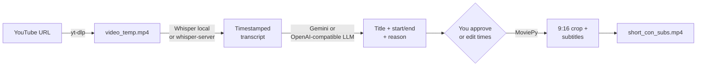

<div align="center">

# 🎬 Miscoshorts AI

**Turn any long YouTube video into a vertical Short with subtitles, picked by AI.**

[](#requirements)
[](https://zulko.github.io/moviepy/)
[-orange)](#run-it-100-local)
[](LICENSE)
[](https://github.com/JoaquinRuiz/miscoshorts-ai/stargazers)

[](#configuration)
[](#run-it-100-local)
[](#run-it-100-local)
[](#run-it-100-local)
[](#configuration)

[](https://youtu.be/zukJLVUwMxA?si=_DQ2RG10uzXtt7yT)

A free, open-source alternative to OpusClip, written in Python. Tutorial in Spanish.

</div>

Miscoshorts downloads a YouTube video, transcribes it with Whisper, asks an LLM for the 30–60 second segment with the most viral potential, crops it to 9:16 and burns in styled subtitles. You approve the suggestion (or type your own timestamps) before anything is rendered.

It works out of the box with **Google Gemini + local Whisper**, and can run **fully on your own machine** with any OpenAI-compatible server (Ollama, LM Studio, llama.cpp) and a whisper.cpp server.

## How it works



## Requirements

- Python 3.12+
- [FFmpeg](https://ffmpeg.org/download.html) in your `PATH`
- One of:
  - a [Google Gemini API key](https://aistudio.google.com/app/apikey) (default), or
  - an OpenAI-compatible LLM server (Ollama, LM Studio, llama.cpp…)

## Install

```bash
git clone https://github.com/JoaquinRuiz/miscoshorts-ai.git
cd miscoshorts-ai
python -m venv .venv && source .venv/bin/activate
pip install -r requirements.txt
```

Install FFmpeg if you don't have it:

```bash
brew install ffmpeg                               # macOS
sudo apt update && sudo apt install ffmpeg        # Ubuntu / Debian
# Windows: https://ffmpeg.org/download.html
```

For the default setup, paste your Gemini key into `GEMINI_API_KEY` in `cerebro_gemini.py`.

## Usage

```bash
python maker.py "https://www.youtube.com/watch?v=VIDEO_ID"
```

The script downloads and transcribes the video, then shows the AI's proposal:

```text
🤖 PROPUESTA DE SHORT:
📌 Título: ...
⏱️ Tiempo: 120.5s --> 155.0s
💡 Razón: ...
¿Te mola? Escribe 's' para crearlo, o introduce nuevos tiempos (ej: 120-140):
```

- `s` renders the suggested segment.
- `120-140` renders your own segment instead.
- Anything else cancels.

The result is saved as `short_con_subs.mp4`.

## Configuration

Everything is set with environment variables. The defaults reproduce the original setup (Gemini + local Whisper).

| Variable | Default | Purpose |
|---|---|---|
| `CEREBRO_BACKEND` | `gemini` | `openai` to use any OpenAI-compatible API instead of Gemini |
| `OPENAI_BASE_URL` | `http://localhost:11434/v1` | LLM endpoint: Ollama `11434`, LM Studio `1234`, llama.cpp `8080` |
| `OPENAI_MODEL` | `qwen3:30b` | Model name as your server exposes it |
| `OPENAI_API_KEY` | `none` | Only if your server requires one |
| `USE_WHISPER_API` | `false` | `true` to transcribe with a remote whisper.cpp `whisper-server` |
| `WHISPER_API_URL` | `http://localhost:9191/inference` | whisper-server endpoint |

Reasoning models are supported: `<think>…</think>` blocks are stripped from the answer before it is parsed.

### Run it 100% local

No API keys and nothing leaves your network:

```bash
# 1. Start an LLM server, e.g. Ollama
ollama pull qwen3:30b

# 2. Start whisper.cpp's server (https://github.com/ggml-org/whisper.cpp)
./whisper-server -m models/ggml-base.bin --port 9191

# 3. Run Miscoshorts against both
CEREBRO_BACKEND=openai OPENAI_MODEL=qwen3:30b USE_WHISPER_API=true \
  python maker.py "https://www.youtube.com/watch?v=VIDEO_ID"
```

Before uploading, the audio is converted to 16 kHz mono WAV with FFmpeg, so whisper-server does not need `--convert`. It must support `response_format=srt`.

### Customising

| What | Where |
|---|---|
| The prompt that picks the viral segment | `cerebro_gemini.py` / `cerebro_openai.py` |
| Gemini model (`gemini-2.5-flash`) | `cerebro_gemini.py` |
| Local Whisper model size (`base`) | `subtitulos_whisper.py` |
| Subtitle font, size (`35`), colour and position | `subtitulos.py` |
| Output filename | `NOMBRE_SALIDA` in `maker.py` |

## Output files

| File | Contents |
|---|---|
| `short_con_subs.mp4` | Final vertical Short with subtitles |
| `transcripcion_completa.txt` | Source URL and the full transcript |
| `video_temp.mp4` | Downloaded video, deleted after rendering |

## Project layout

```text
maker.py               Entry point: download, pick backend, crop, render
cerebro_gemini.py      Segment selection with Google Gemini
cerebro_openai.py      Segment selection with any OpenAI-compatible API
subtitulos_whisper.py  Transcription: local Whisper or whisper-server (SRT)
subtitulos.py          Subtitle layer with MoviePy
requirements.txt       Python dependencies
```

## Troubleshooting

<details>
<summary><b>Font errors when rendering subtitles</b></summary>

Change `font` in `subtitulos.py` to one installed on your system, e.g. `LiberationSans-Bold`, `Arial-Bold` or `Ubuntu-Bold`. On Linux:

```bash
sudo apt install fonts-dejavu-core fonts-liberation
```
</details>

<details>
<summary><b><code>module 'whisper' has no attribute 'load_model'</code></b></summary>

You have the wrong `whisper` package:

```bash
pip uninstall whisper
pip install openai-whisper
```
</details>

<details>
<summary><b>MoviePy / FFmpeg errors</b></summary>

Check FFmpeg is installed and in your `PATH` with `ffmpeg -version`. Miscoshorts uses the MoviePy v2 API (`subclipped`, `cropped`); MoviePy 1.x will not work.
</details>

<details>
<summary><b>Gemini API errors</b></summary>

Check the key is valid, the model name (`gemini-2.5-flash`) is available to your account and you are within the rate limits.
</details>

<details>
<summary><b>whisper-server returns no segments</b></summary>

Miscoshorts asks for `response_format=srt` and fails with the first characters of the response if it cannot parse it. Check `WHISPER_API_URL` points to the `/inference` endpoint.
</details>

## Contributing

Issues and pull requests are welcome: read [CONTRIBUTING.md](CONTRIBUTING.md) first. Thanks to [@Jay4242](https://github.com/Jay4242) for the OpenAI-compatible and whisper-server backends.

## Author

Made by **Joaquín Ruiz**: [YouTube @jokioki](https://youtube.com/@jokioki) · [LinkedIn](https://linkedin.com/in/jokiruiz)

If this code helped you, understanding the logic behind the AI is what will set you apart as an engineer. My books on AI (in Spanish):

| Book | About |
|---|---|
| 📘 [Del vibe coding al Spec-Driven Development](https://amzn.eu/d/01rDtuzH) | SDD, Spec-Kit and AI agents in real projects |
| ⚙️ [El motor de la Inteligencia Artificial](https://amzn.eu/d/083CTN3U) | Transformers and neural networks; build your own GPT |
| 💻 [Programar con Inteligencia Artificial](https://amzn.eu/d/eK4f73N) | MCP, vibe coding and agents, with real code |
| 🔭 [Explora la Inteligencia Artificial](https://amzn.eu/d/dSwYhue) | The big picture of today's AI ecosystem |

[](https://www.amazon.es/stores/Joaqu%C3%ADn-Ruiz/author/B0DW43DPSF)

## License

[MIT](LICENSE)
