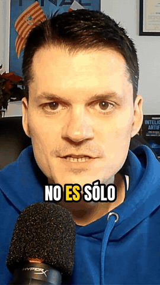
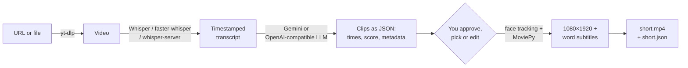

<div align="center">

# 🎬 Miscoshorts AI

**Turn any long YouTube video into vertical Shorts with subtitles, picked by AI.**

[](https://github.com/JoaquinRuiz/miscoshorts-ai/actions/workflows/ci.yml)
[](#requirements)
[](https://zulko.github.io/moviepy/)
[-orange)](#run-it-100-local)
[](LICENSE)
[](https://github.com/JoaquinRuiz/miscoshorts-ai/stargazers)

[](#configuration)
[](#run-it-100-local)
[](#run-it-100-local)
[](#run-it-100-local)
[](#configuration)

[](https://youtu.be/zukJLVUwMxA?si=_DQ2RG10uzXtt7yT)

A free, open-source alternative to OpusClip, written in Python. Tutorial in Spanish.

</div>

Miscoshorts downloads a video, transcribes it with Whisper, asks an LLM for the 30–60 second segments with the most viral potential, reframes them to 9:16 following the speaker's face and burns in word-by-word subtitles. You approve the proposals (or type your own timestamps) before anything is rendered, and you get a title, description and hashtags ready to paste.

It works out of the box with **Google Gemini + local Whisper**, and can run **fully on your own machine** with any OpenAI-compatible server (Ollama, LM Studio, llama.cpp) and Whisper or a whisper.cpp server.

<div align="center">
  
  <br><sub>Made 100% locally from <a href="https://youtu.be/zukJLVUwMxA">the tutorial</a> with Whisper + <code>qwen3:8b</code> on Ollama.</sub>
</div>

## Features

- 🎥 YouTube (or any [yt-dlp](https://github.com/yt-dlp/yt-dlp) site) in the best available quality, or a **local video file**
- 🔍 Transcription with **Whisper**, **faster-whisper** or a **whisper.cpp server**, cached so you only transcribe once
- 🤖 Segment selection with **Gemini** or any **OpenAI-compatible** LLM, as validated JSON, with a retry when the answer is wrong
- 🎬 **Several Shorts per video** (`-n 3`), without overlaps, ranked by viral score
- 🎯 **Smart crop** that follows the speaker's face, with centre crop as fallback
- 📝 **"Shorts style" subtitles**: a few words at a time, the current word highlighted, bundled font on every OS
- 📐 Exported at **1080×1920** and the source frame rate, ready to upload
- 🏷️ **Title, description and hashtags** for YouTube / TikTok / Reels next to every video
- 📚 **Long videos** are split into chunks so local models with small contexts can handle them

## How it works



## Requirements

- Python 3.10+
- [FFmpeg](https://ffmpeg.org/download.html) in your `PATH`
- One of:
  - a [Google Gemini API key](https://aistudio.google.com/app/apikey) (default), or
  - an OpenAI-compatible LLM server (Ollama, LM Studio, llama.cpp…)

## Install

```bash
git clone https://github.com/JoaquinRuiz/miscoshorts-ai.git
cd miscoshorts-ai
python -m venv .venv && source .venv/bin/activate
pip install -e ".[all]"        # or just `pip install -e .` without smart crop / faster-whisper
```

Optional extras: `smartcrop` (OpenCV face tracking), `faster` (faster-whisper), `all` (both). `pip install -r requirements.txt` still works and installs the base package.

Install FFmpeg if you don't have it:

```bash
brew install ffmpeg                               # macOS
sudo apt update && sudo apt install ffmpeg        # Ubuntu / Debian
# Windows: https://ffmpeg.org/download.html
```

For the default setup, put your Gemini key in a `.env` file in the folder where you run the command (or export it):

```bash
echo "GEMINI_API_KEY=your-key" > .env
```

## Usage

```bash
miscoshorts "https://www.youtube.com/watch?v=VIDEO_ID"
```

`python maker.py URL` and `python -m miscoshorts URL` do the same. The tool downloads and transcribes the video, then shows the AI's proposals:

```text
🤖 PROPUESTAS DE SHORT (2):
 [1] ⭐ 9  📌 El truco que nadie te cuenta
     ⏱️  2:00.5 → 2:35.0  (34.5s)
     💡 Gancho fuerte y una idea completa
 [2] ⭐ 7  📌 ...
¿Te mola? 's' (o Enter) para crearlos todos, números para elegir (ej: 1,3), nuevos tiempos (ej: 120-140 o 2:00-2:20), o 'q' para salir:
```

Each Short is saved as an `.mp4` with a `.json` next to it holding the title, description, hashtags and times.

### Examples

```bash
miscoshorts video.mp4                                  # local file
miscoshorts URL -n 3                                   # three Shorts from the same video
miscoshorts URL -n 3 --yes -o out/short.mp4            # no questions: out/short_1.mp4 … _3.mp4
miscoshorts URL --start 2:00 --end 2:35                # your own segment, no AI needed
miscoshorts URL --lang es --whisper-model small        # better transcription for Spanish
miscoshorts URL --min-seconds 15 --max-seconds 30      # shorter clips
miscoshorts URL --crop center --words-per-caption 1    # fixed crop, one word at a time
miscoshorts --help                                     # every option
```

## Configuration

Every setting can be an environment variable or a line in `.env`; command-line options win over both. The defaults reproduce the original setup (Gemini + local Whisper).

| Variable | Option | Default | Purpose |
|---|---|---|---|
| `CEREBRO_BACKEND` | `--backend` | `gemini` | `openai` to use any OpenAI-compatible API |
| `GEMINI_API_KEY` | | | Your Gemini key (`GOOGLE_API_KEY` also works) |
| `GEMINI_MODEL` | `--model` | `gemini-2.5-flash` | Gemini model |
| `OPENAI_BASE_URL` | | `http://localhost:11434/v1` | LLM endpoint: Ollama `11434`, LM Studio `1234`, llama.cpp `8080` |
| `OPENAI_MODEL` | `--model` | `qwen3:30b` | Model name as your server exposes it |
| `OPENAI_API_KEY` | | `none` | Only if your server requires one |
| `MAX_TRANSCRIPT_CHARS` | `--chunk-chars` | 10 000 (OpenAI) / 400 000 (Gemini) | Longer transcripts are split into chunks |
| `WHISPER_ENGINE` | `--whisper-engine` | `openai-whisper` | `faster-whisper` is several times faster on CPU |
| `WHISPER_MODEL` | `--whisper-model` | `base` | `tiny` … `large-v3`: bigger is slower and more accurate |
| `WHISPER_LANGUAGE` | `--lang` | auto | Spoken language, e.g. `es` |
| `USE_WHISPER_API` | `--whisper-api` | `false` | Transcribe with a whisper.cpp `whisper-server` |
| `WHISPER_API_URL` | | `http://localhost:9191/inference` | whisper-server endpoint |
| `MISCOSHORTS_CACHE_DIR` | `--no-cache` | `~/.cache/miscoshorts` | Where transcripts are cached |
| `CROP_MODE` | `--crop` | `auto` | `smart` (faces), `center`, or `auto` = smart if OpenCV is installed |

Reasoning models are supported: `<think>…</think>` blocks are stripped before the answer is parsed.

### Subtitles

| Variable | Option | Default | Purpose |
|---|---|---|---|
| `SUBTITLE_FONT` | `--font` | bundled Anton | Font file path or name |
| `SUBTITLE_WORDS` | `--words-per-caption` | `3` | Words on screen at once |
| `SUBTITLE_SIZE` | | `0.06` | Font size as a fraction of the video height |
| `SUBTITLE_POSITION` | | `0.68` | Vertical position (0 = top, 1 = bottom) |
| `SUBTITLE_COLOR` / `SUBTITLE_HIGHLIGHT` | | `white` / `#FFD400` | Text and current-word colours |
| `SUBTITLE_STROKE_COLOR` | | `black` | Outline colour |
| `SUBTITLE_UPPERCASE` | | `true` | Uppercase captions |

### Run it 100% local

No API keys and nothing leaves your network:

```bash
# 1. An LLM server, e.g. Ollama
ollama pull qwen3:8b

# 2. Run Miscoshorts with local Whisper and the local LLM
CEREBRO_BACKEND=openai OPENAI_MODEL=qwen3:8b \
  miscoshorts "https://www.youtube.com/watch?v=VIDEO_ID"
```

To transcribe with [whisper.cpp](https://github.com/ggml-org/whisper.cpp) instead, start `./whisper-server -m models/ggml-base.bin --port 9191` and add `--whisper-api`. The audio is converted to 16 kHz mono WAV first, so the server does not need `--convert`; it must support `response_format=srt`. whisper-server gives no word timestamps, so word timings are estimated within each subtitle line.

## Output files

| File | Contents |
|---|---|
| `short_con_subs.mp4` (or `-o`) | Final vertical Short; with `-n` they are numbered `_1`, `_2`… |
| `short_con_subs.json` | Title, description, hashtags, reason, score and times |
| `transcripcion_completa.txt` | Source URL and the full transcript |

The downloaded video goes to a temporary folder that is always deleted, even if something fails.

## Project layout

```text
miscoshorts/
├── cli.py          Command line and the pipeline
├── config.py       Settings from env / .env
├── download.py     yt-dlp download or local file
├── transcribe.py   Whisper, faster-whisper, whisper-server + cache
├── llm.py          Prompt, Gemini / OpenAI backends, chunking, retries
├── clips.py        Parse, validate and rank the LLM's clips
├── captions.py     Group words into captions
├── subtitles.py    Draw captions with Pillow
├── smartcrop.py    Face tracking with OpenCV
├── render.py       Reframe, resize and export with MoviePy
└── assets/fonts/   Anton (SIL Open Font License)
tests/              pytest
maker.py            `python maker.py URL`, kept for the tutorial
```

## Troubleshooting

<details>
<summary><b><code>Falta GEMINI_API_KEY</code></b></summary>

Put `GEMINI_API_KEY=…` in a `.env` file in the folder where you run `miscoshorts`, export it, or use a local model with `--backend openai`.
</details>

<details>
<summary><b>The AI proposes invalid segments</b></summary>

Miscoshorts validates every proposal (inside the video, start before end, about `--min-seconds`–`--max-seconds`) and asks the model again once with the problems. Small local models sometimes still fail: try a bigger model, lower `--chunk-chars` or type the times yourself at the prompt.
</details>

<details>
<summary><b>Smart crop isn't used</b></summary>

Install the extra with `pip install -e ".[smartcrop]"`. If no face is found in most of the clip (screen recordings, B-roll) it falls back to the centre on purpose.
</details>

<details>
<summary><b><code>module 'whisper' has no attribute 'load_model'</code></b></summary>

You have the wrong `whisper` package:

```bash
pip uninstall whisper
pip install openai-whisper
```
</details>

<details>
<summary><b>MoviePy / FFmpeg errors</b></summary>

Check FFmpeg is installed and in your `PATH` with `ffmpeg -version`. Miscoshorts uses the MoviePy v2 API; MoviePy 1.x will not work.
</details>

<details>
<summary><b>whisper-server returns no segments</b></summary>

Miscoshorts asks for `response_format=srt` and fails with the first characters of the response if it cannot parse it. Check `WHISPER_API_URL` points to the `/inference` endpoint.
</details>

## Development

```bash
pip install -e ".[all,dev]"
pytest          # unit tests + a small render test (needs FFmpeg)
ruff check . && ruff format --check .
```

CI runs the same on every pull request.

## Contributing

Issues and pull requests are welcome: read [CONTRIBUTING.md](CONTRIBUTING.md) first. Thanks to [@Jay4242](https://github.com/Jay4242) for the OpenAI-compatible and whisper-server backends.

## Author

Made by **Joaquín Ruiz**: [YouTube @jokioki](https://youtube.com/@jokioki) · [LinkedIn](https://linkedin.com/in/jokiruiz)

If this code helped you, understanding the logic behind the AI is what will set you apart as an engineer. My books on AI (in Spanish):

| Book | About |
|---|---|
| 📘 [Del vibe coding al Spec-Driven Development](https://amzn.eu/d/01rDtuzH) | SDD, Spec-Kit and AI agents in real projects |
| ⚙️ [El motor de la Inteligencia Artificial](https://amzn.eu/d/083CTN3U) | Transformers and neural networks; build your own GPT |
| 💻 [Programar con Inteligencia Artificial](https://amzn.eu/d/eK4f73N) | MCP, vibe coding and agents, with real code |
| 🔭 [Explora la Inteligencia Artificial](https://amzn.eu/d/dSwYhue) | The big picture of today's AI ecosystem |

[](https://www.amazon.es/stores/Joaqu%C3%ADn-Ruiz/author/B0DW43DPSF)

## License

[MIT](LICENSE). The bundled Anton font is under the [SIL Open Font License](miscoshorts/assets/fonts/OFL.txt).
